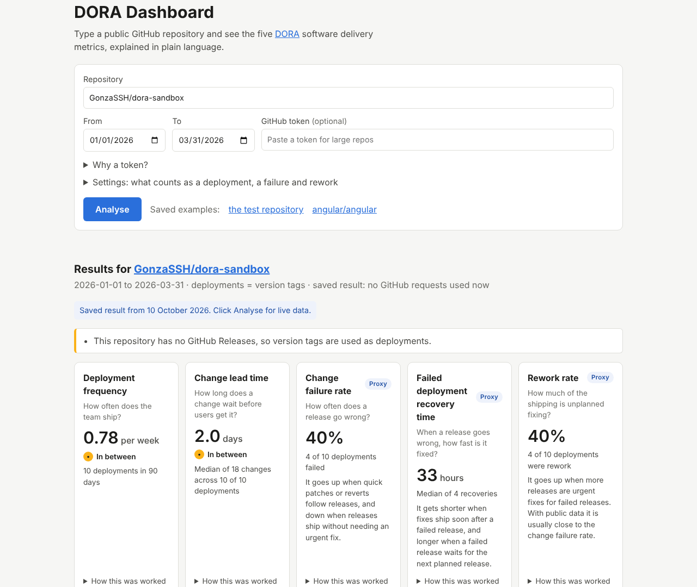

# DORA Dashboard

**See how well any public GitHub project delivers software, in plain language.**

**Live demo: https://gonzassh.github.io/dora-dashboard/**
· [Try it on the test repository](https://gonzassh.github.io/dora-dashboard/?repo=GonzaSSH/dora-sandbox&from=2026-01-01&to=2026-03-31)
· [Try it on grafana/grafana](https://gonzassh.github.io/dora-dashboard/?repo=grafana/grafana)

Type a repository like `grafana/grafana` and get the five
[DORA](https://dora.dev/guides/dora-metrics/) software delivery metrics, each with a
short plain-language explanation. It runs entirely in your browser:
no sign-up, no server, nothing stored.



## The problem, and why DORA still matters when AI writes the code

Teams often judge delivery by gut feel or by activity counts (commits, tickets closed).
DORA's research boils delivery performance down to five outcomes: how often you ship,
how fast a change reaches users, how often a release breaks, how fast you recover, and
how much work is unplanned fixing.

AI assistants make writing code much faster, but code written isn't value delivered.
More, faster changes can mean bigger batches, more failed releases and more rework if
testing and release practices don't keep up. DORA's
[2024 research](https://dora.dev/research/2024/dora-report/) found that teams using more
AI saw slightly *lower* delivery throughput and stability. DORA metrics measure the
outcome, not the typing, so they're how you tell whether AI is actually helping a team ship.

## How to use it

1. Open the [live demo](https://gonzassh.github.io/dora-dashboard/).
2. In **Repository**, type the project's GitHub name as `owner/name`, for example
   `grafana/grafana`. You can also paste its GitHub address.
3. Choose the **From** and **To** dates. The default is the last 90 days.
4. Click **Analyse**. A small project takes a few seconds; a very busy one up to about 30.
5. Read the five tiles. Open **How this was worked out** under any tile, or the list of
   deployments below them, to see exactly what was counted.
6. To share the result, copy the page address. It holds the repository and dates
   (never your token).

### What each metric means

| Metric | The question it answers | Rough guide |
|---|---|---|
| **Deployment frequency** | How often does the team ship? | strong: daily or more · weak: less than once a month |
| **Change lead time** | How long does a change wait before users get it? | strong: under a day · weak: over a month |
| **Change failure rate** *(proxy)* | How often does a release go wrong? | no rating: higher when quick patches or reverts follow releases |
| **Failed deployment recovery time** *(proxy)* | When a release goes wrong, how fast is it fixed? | no rating: shorter when fixes ship soon after a failed release |
| **Rework rate** *(proxy)* | How much of the shipping is unplanned fixing? | no rating: higher when more releases are urgent fixes for failed releases |

Only the two directly measured metrics get a "strong / weak" rough guide. The three
proxies are estimates, so the app shows the number and what moves it, not a verdict.
Compare a team with its own past, not with other teams.

### If something goes wrong

| You see | What to do |
|---|---|
| "We couldn't find that repository" | Check the spelling (`owner/name`). The project may also be private; only public ones work. |
| "Nothing to measure in this period" | The project made no releases in those dates. Pick a longer period, or under **Settings** change what counts as a deployment. |
| "GitHub's hourly limit is used up" | GitHub allows 60 requests per hour without a token. Wait until the time shown, or add a token (below). |
| "Couldn't reach GitHub" | Check your internet connection. Some company networks block GitHub's API. |
| A yellow note saying a **sample** was used | The project is so busy that, without a token, only the newest releases were examined in detail. Add a token for the full picture. |

**Adding a token (optional).** On GitHub open *Settings → Developer settings → Personal
access tokens → Fine-grained tokens → Generate new token*, choose "Public repositories"
access, generate it and paste it into **GitHub token**. It stays in that browser tab
only: it is sent to GitHub and nowhere else, never saved, and forgotten when you reload.

## How the metrics are calculated

Full definitions are in [PLAN.md](PLAN.md#2-the-five-metrics-exact-formulas). In short:

- **Deployment** = a published GitHub Release (or, if the project has none, a version tag
  such as `v1.2.3`). Pre-releases are ignored. This is configurable under **Settings**.
- **Deployment frequency** = deployments ÷ weeks in the period.
- **Change lead time** = for every commit in each release, release time − time the commit
  was written. The median is shown. Each release is compared with the previous version on
  the same line (so 11.6.5 is compared with 11.6.4, not with 12.1.0).
- **Change failure rate** = failed releases ÷ all releases. A release counts as **failed**
  if a quick patch followed (1.2.0 → 1.2.1 within 48 hours) or a later release reverts
  one of its commits.
  - **How a revert is traced:** by the commit or pull request it names. When that doesn't
    work, for example because the fix was copied to a maintenance branch under a new commit
    ID, it's traced by the original commit's title.
  - **A revert inside the same release** as the change fails nothing, because users never got
    the change.
  - **Reverts that can't be traced** fail nothing, and are listed under one collapsed note.
- **Recovery time** = time from a failed release to the first good release after it (median).
- **Rework rate** = releases that fixed a detected failed release ÷ all releases. If a fix
  itself fails and needs another fix, both fix releases count.
  - **With public data this is usually close to the change failure rate.** Both come from
    the same detected failures, so read them together, not as two independent signals.
  - **That is DORA's own view.** Its [history of the metrics](https://dora.dev/insights/dora-metrics-history/)
    says change failure rate "acted as a proxy for the amount of rework a team must
    perform", and rework rate was added in 2024 to test that.
  - **Why not count every patch release?** That was tried first, and on five real projects
    (angular, vite, vitest, nuxt, grafana) it gave **75–96% rework**, because libraries ship
    planned patch releases all the time. It is still available under **Settings** as a
    broad, non-default reading.

### Honest limitations

- **Three of the five metrics are proxies.** Public repositories don't publish incidents
  or outages, so failures are inferred from release patterns. A real outage that was
  fixed in a normal release is invisible; a planned quick patch is counted as a failure.
- **Rework and failure rate move together.** With public data both come from the same
  detected failures (see above), so a low rework rate mostly means few *detected* failures.
- **Failures are only detected through quick patches and reverts.** grafana/grafana is the
  example: it ships about two releases a week, yet over the last 90 days the app detects
  0% failures, because grafana fixes problems in normal releases rather than quick patches
  or reverts. A real outage fixed that way is invisible to these proxies.
- **Reverts are traced by commit ID or title.** A revert that names neither a commit nor
  a pull request, and whose title matches no released commit, can't be traced; it fails
  nothing and the page lists it.
- **A release is not always a deployment.** Libraries publish releases that users adopt
  later; services may deploy many times between releases.
- **Busy projects are sampled without a token.** To stay under GitHub's 60 requests per
  hour, at most 50 requests are made; the newest releases are examined first and the page
  says when a sample was used.
- **GitHub lists at most 250 commits per comparison**, so very large releases are only
  partly counted (the page says so).
- Lead time uses the commit's "written" date, which authors can set freely.

## How it was tested

- **A test repository with known answers.** [GonzaSSH/dora-sandbox](https://github.com/GonzaSSH/dora-sandbox)
  has a scripted, backdated history ([build-sandbox.sh](sandbox/build-sandbox.sh)) with
  normal releases, two failures with recoveries and a rework release. The expected value
  of every metric was worked out **by hand before any metric code was written**:
  [sandbox/EXPECTED.md](sandbox/EXPECTED.md).
- **Unit tests** (Vitest, 65 tests) check that every metric equals EXPECTED.md exactly,
  plus the edge cases of each rule, every error case and that the token is never leaked.
  They run offline against recorded GitHub responses.
- **End-to-end tests** (Playwright, desktop and phone sizes) drive the real page: the full
  flow, changing settings, the token never being stored, and each error message.
- **Live checks** run against the real GitHub API: the real sandbox must match
  EXPECTED.md, and `grafana/grafana` must finish within the request budget.
- **CI** ([workflow](.github/workflows/ci.yml)) runs all of the above on every push,
  then deploys to GitHub Pages and checks the deployed site shows the expected numbers.
- An **independent AI review** checked the code against the plan and the expected values. It found 7 gaps (e.g. backport releases on older version lines being missed, and the wrong message when GitHub's limit ran out mid-run); each got a regression test and a fix.

## Built with Claude Code

I'm a delivery lead, not a developer. I built this with
[Claude Code](https://claude.ai/code) to see how far a non-developer can get by owning
the *what* and the *quality bar*, and delegating the *how*.

**What I decided**
- The goal, the audience and the five metrics, and what was out of scope for version 1.
- **The metric definitions.** I reviewed each default against how I've run DORA in real
  companies:
  - **What counts as a deployment:** kept as stable versions only.
  - **The 48-hour quick-patch window:** kept.
  - **The revert rule:** made strict. A revert only fails the release that shipped the
    reverted commit, including reverts made with GitHub's Revert button.
  - **The rework rule:** I first chose "every patch release". On real data it gave
    75–96% rework on five projects, so I changed it to releases that fixed a detected
    failure, kept the broad reading as a non-default setting, and asked for a sandbox case
    where one failure needs two fixes.
  - **Copied commits:** I had reverts matched by title when a fix was copied to another
    branch under a new commit ID (found while checking angular's numbers).
  - **The ratings:** limited to the two directly measured metrics. The three proxies are
    estimates and get no verdict.
- The quality bar: a test repository with hand-worked answers written before any code,
  tests that may never be weakened to pass, live checks against real projects, and an
  independent review.
- Working in phases with my approval between them, and the main trade-offs Claude put to
  me: Playwright instead of Cypress (Cypress couldn't be installed in the build
  environment), a 90-day default period, merging every change myself via pull requests,
  and letting GitHub Actions rebuild the test repository.
- The GitHub settings only a repository owner can change (making repositories public,
  turning on Pages).

**What the AI did**
- The first draft of the formulas and proxy rules (which I then reviewed and changed),
  and the test-repository design.
- All the code, tests, CI pipeline and this README's first draft.
- All testing and debugging, including finding and fixing its own test mistakes.

## What I would build next

- **Split the metrics by AI-assisted commits** (e.g. commits with an AI co-author
  trailer) to compare AI-assisted and other changes directly.
- Trends over time: the same metrics month by month, to show whether a team is improving.
- More failure signals: bug-labelled issues opened soon after a release, and GitHub
  Deployments / Actions runs as a deployment source.
- Smarter fix detection that doesn't depend on `fix:` commit prefixes (e.g. pull request labels).
- Fewer requests per analysis (GitHub's GraphQL API) so large projects need no sample.

## For developers

```bash
npm ci
npm run dev          # local app
npm test             # unit tests
npm run e2e          # end-to-end tests (Playwright)
```

See [CLAUDE.md](CLAUDE.md) for all commands and project rules.
